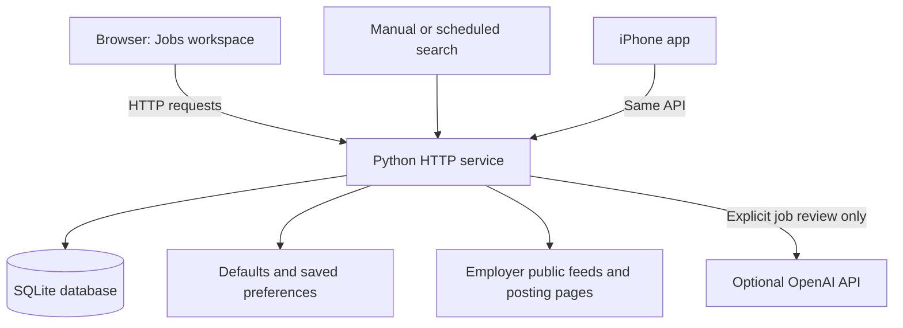

# Jobs: complete project guide

This guide describes Build 9 of the single-workspace prototype. Start with the [approved product vision](PRODUCT-VISION.md) for product goals, the [README](../README.md) for quick start, the [verification record](VERIFICATION.md) for observed results, and the [roadmap](NEXT-STEPS.md) for open work.

## Contents

1. [What this project is](#1-what-this-project-is)
2. [How it grew](#2-how-it-grew)
3. [The architecture in plain English](#3-the-architecture-in-plain-english)
4. [What each screen does](#4-what-each-screen-does)
5. [Follow one job through the system](#5-follow-one-job-through-the-system)
6. [How employer discovery works](#6-how-employer-discovery-works)
7. [How matching and verification work](#7-how-matching-and-verification-work)
8. [Where AI fits](#8-where-ai-fits)
9. [What the database stores](#9-what-the-database-stores)
10. [The file map](#10-the-file-map)
11. [Preferences and configuration](#11-preferences-and-configuration)
12. [Running and stopping the app](#12-running-and-stopping-the-app)
13. [Tests and development](#13-tests-and-development)
14. [The API](#14-the-api)
15. [Backups and recovery](#15-backups-and-recovery)
16. [Moving to the Mac](#16-moving-to-the-mac)
17. [Git and GitHub](#17-git-and-github)
18. [The iPhone app](#18-the-iphone-app)
19. [Troubleshooting](#19-troubleshooting)
20. [Limits and next milestones](#20-limits-and-next-milestones)
21. [Learning and presenting the project](#21-learning-and-presenting-the-project)
22. [Glossary](#22-glossary)

## 1. What this project is

Jobs is a personal career workspace. It discovers jobs from employer sources, evaluates them against explicit preferences, helps the owner review uncertain details, and preserves application progress across browsers and devices connected to the same server.

It addresses a practical problem: collecting links is easy; knowing which links are current, relevant, eligible and already acted upon is harder. The application brings those questions into one workflow.

The implemented capabilities are:

- Employer-board retrieval from Greenhouse, Ashby, Lever, SmartRecruiters and Personio.
- Limited discovery through public web search and best-effort extraction from other employer posting URLs.
- Location, published base-salary and title checks.
- Configurable skill-weight scoring with readable explanations.
- Separate human review, application tracking and optional AI career advice.
- Employer-source health and pause/resume controls.
- Manual and daily searches, backups, audit records and cross-device save-conflict detection.
- Responsive browser screens and a native SwiftUI iPhone app using the same API. The phone can read its last synced copy offline.

Users submit applications on the employer’s website. The current prototype serves one shared workspace on a trusted private network. The product vision calls for private customer accounts, truthful application preparation, and a paid, ad-free service.

## 2. How it grew

The starting point was a static HTML job directory. Its job cards were embedded in a file rather than retrieved from a database. The original personal directory was preserved as `original.html`.

A Python service and SQLite database then added persistence, live employer checks, scheduled discovery and application tracking. A review workflow added human approval, holds and dismissal without deleting history. The November 10 prototype added editable preferences, configurable skill weights, employer health, fair source rotation, optional requested AI reviews and Mac handoff documentation.

GitHub holds distributable source with an empty startup seed and fictional regression fixtures. Keep the real directory, candidate profile, applications, notes and research in the private workspace and its separate backups.

The implementation uses AI-assisted development. Its portfolio value comes from understanding its design, testing changes, diagnosing failures and being able to explain what you built and why.

## 3. The architecture in plain English

There are four main layers:

| Layer | Technology | Job |
| --- | --- | --- |
| Clients | HTML/CSS and SwiftUI | Present the browser and native iPhone workflows |
| Browser behavior | JavaScript | Loads the dashboard, filters cards, sends changes and displays feedback |
| Backend | Python standard library | Retrieves sources, applies rules, calls optional AI and handles HTTP requests |
| Persistent storage | SQLite and JSON files | Keeps listings, decisions, application history and preferences |

Docker Compose can run the Python backend with source and data mounted from the host. The backend can also run directly in Python. Use a single authoritative service per live database.



Both clients use the Python API. The backend owns SQLite writes, source retrieval and paid provider credentials. Employer refreshes own listing facts. User actions own reviews, application history and profile choices. AI reviews store advice separately. Separate backend installations have independent data, and the iPhone offline copy is read-only.

## 4. What each screen does

### Jobs

The main screen has search controls, a search-run summary, workflow buckets and job cards. You can search text, filter by company/category/location/status/pay/score/dates, and sort the current view. Quick views help find support, implementation and due follow-ups. They are shortcuts, not independent saved search profiles.

Each card shows the employer, role, salary evidence, location, rule score, explanation and current states. Expand sections for the employer description, AI career advice, human review or application tracking.

| Bucket | Meaning |
| --- | --- |
| Review Inbox | Opportunities needing a human decision, including uncertain eligibility |
| Ready to Apply | Approved by the owner and not recorded as applied, with no current hard approval blocker |
| Applied | Recorded applications and assessments |
| Interviews | Scheduled or completed interviews |
| Offers | Offer received |
| On Hold | Owner is waiting for information or a later decision |
| Closed / Dismissed | Closed listings, terminal application statuses or dismissed opportunities |
| All History | All retained records, including excluded locations and historical entries |

Bucket assignment is implemented by `bucket()` in `site/dashboard.js`. Closed listings go to the archive even if a prior application remains recorded. The status and notes still exist; moving a card does not erase them. All History is useful when a card seems to disappear from an opportunity view.

### Employer boards

This screen explains which sources are watched, when each was attempted, what it returned, and whether it needs attention. A source can be healthy, failed, awaiting its first check, or require manual review. Pausing a source prevents its next fetch; it does not delete its jobs or treat them as closed.

Source health is the outcome of the last attempt. A healthy feed does not mean every job matches your preferences. A healthy page extraction does not establish every requirement or guarantee an available application.

### Preferences

This screen edits the candidate profile, title phrases, exclusions, pay rules, skill weights, added board slugs, other posting URLs, daily schedule and AI settings. Save changes explicitly. A revision check prevents another device's settings from being silently overwritten.

Some settings remain file-based: local geography definitions, search caps and verification freshness are examples. The current location implementation still has Florida/Georgia-specific rules and wording; this is not a general multi-location search platform yet.

### How it works

This is an in-app explanation of discovery, matching and human decisions. The browser and iPhone use the same backend records.

## 5. Follow one job through the system

Imagine a fictional employer publishes an Implementation Specialist role.

1. A search retrieves the employer feed. A source adapter converts its response into common fields such as title, employer, URL, location and description.
2. The application identifies the posting by its recruiting platform, employer board and requisition ID, or by its full employer URL. Similar titles and locations can belong to different openings.
3. Matching examines the current description, location, pay and title. A keyword score explains the experience overlap; it is not a hiring prediction.
4. If the hard checks and score qualify, the service attempts to confirm evidence on the exact application page. A dynamic or inaccessible form remains uncertain.
5. Listing facts are inserted or refreshed in `jobs`. A new record receives a separate tracking record beginning as Needs Verification.
6. You read the employer posting, confirm the checklist and decide whether to approve, hold or dismiss. Uncertain automatic checks require an explanatory note before approval.
7. Approval places an eligible unapplied record in Ready to Apply. It does not send anything to the employer.
8. You apply on the employer site and record that fact, the application date, notes and follow-up date.
9. Later searches refresh listing facts. They preserve your application and review rows, even when the employer closes the posting.

The key design is **separate ownership of facts, decisions and history**. A crawler can update employer facts; it cannot decide that you applied. An AI can suggest questions; it cannot approve the listing.

### Track an application found elsewhere

Choose **Add Application** in the browser's Jobs view or on iPhone under **My Jobs**. Enter the job title and employer. The location, HTTPS posting link, application date, follow-up date and notes are optional. Choose the current application status. The record appears in that stage and uses the usual tracking editor and follow-ups.

Jobs labels these details **Added by you**. The link is optional and opening it is your choice. Adding the record does not check the URL, add a search source, score the role or send an alert. If a later search saves the same exact posting, employer facts can take the place of the entered posting details while the application history stays attached. Jobs detects duplicate posting links and uses the supplied employer, title and location when a link is missing.

## 6. How employer discovery works

### Direct public ATS feeds

An applicant tracking system, or ATS, hosts an employer's recruitment board. `board_jobs()` supports these feeds.

| Platform | Board URL pattern | Direct adapter |
| --- | --- | --- |
| Ashby | `https://jobs.ashbyhq.com/BOARD` | Public job-board endpoint, including available compensation fields |
| Greenhouse | `https://job-boards.greenhouse.io/BOARD` | Public board jobs endpoint with descriptions |
| Lever | `https://jobs.lever.co/BOARD` | Public postings endpoint |
| SmartRecruiters | `https://jobs.smartrecruiters.com/BOARD` | Public Posting API with pagination and per-requisition details |
| Personio | `https://BOARD.jobs.personio.com` (also `.de` links) | Employer-enabled XML feed and exact requisition page check |

The board slug is the employer identifier in the URL. Enter that slug in the matching Preferences field. A job-specific URL and a board URL are different: the former identifies one requisition; the latter identifies the feed to revisit.

Board names are normalized to lowercase. Existing jobs, configured additions and stored source history contribute watched boards. This lets a successfully fetched board remain watched even if it initially has no matching jobs.

These feeds do not require Firecrawl. They are the foundation of the current search pipeline. Public availability does not imply exhaustive coverage or permission to bypass site controls.

The SmartRecruiters adapter checks the complete public index, up to 3,000 postings per board, before treating a missing requisition as closed. Each run checks details for up to eight tracked postings and sixteen new postings per board. The new-posting budget prioritizes enabled saved searches with title criteria, then the main search profile. A share of the budget rotates through other postings. The run report shows how many board details were deferred. [SmartRecruiters Posting API](https://developers.smartrecruiters.com/docs/endpoints)

Personio feeds use the employer’s career-site slug and the public English XML feed. Jobs checks the exact requisition page before reporting a result as open or sending a match alert. It checks the application form separately and leaves pay unknown when the feed does not supply verified base pay. A posting missing from the feed needs verification; it is not marked closed based on that absence alone. [Personio XML setup](https://support.personio.de/hc/en-us/articles/207576365-Integrate-jobs-from-Personio-into-your-website-via-XML) · [Personio posting links](https://developer.personio.de/docs/integration-of-open-positions)

### Public web discovery

When enabled, bounded Bing RSS searches rotate across role phrases, regions and ATS domains. Search results can add board candidates or generic employer URLs. A search engine can block requests, return irrelevant results or omit employers. A successful query does not establish that it found all suitable vacancies.

### Other employer pages

`generic_posting()` tries to extract a single structured `JobPosting` from a public page and establish an employer relationship and application evidence. Missing structure, multiple ambiguous postings or unsupported dynamic content remain manual-review sources.

There is no universal Workday adapter. A careers homepage is not automatically a supported complete employer-board feed. For an unsupported employer, a job-specific URL and manual verification are often necessary.

Generic URLs are attempted least-recently-checked first. Repeated failures cannot permanently consume the same first slots. The list of deferred URLs is retained in the report. Board rechecks prioritize saved-search matches waiting for a direct posting check, then older verification timestamps.

Employer URLs preserve query parameters that may identify a posting. Jobs ignores ordinary anchors and recognized tracking parameters, such as UTM tags and Greenhouse attribution. Two openings on the same page path can have separate tracking records and alerts. Multiple links to the same posting count as one source check per run.

When an older saved URL supplies enough information to update its key, Jobs updates the key on the same record and flags its history for review. If retained records disagree, the affected entries stay in review. Automatic refresh and CSV history import skip those entries until the ambiguity can be resolved. Their existing notes, decisions and drafts stay attached to their original records. A key migration cannot recover a posting that an older release already overwrote.

### One complete search run

`run_pipeline()` backs up the database, loads preferences and history, discovers sources, fetches boards, refreshes existing requisitions, evaluates new candidates, attempts bounded generic URLs and saves a report. Manual and scheduled runs share this pipeline and a process lock.

The pipeline collects candidates from the checked sources before applying the new-listing limit. It prioritizes roles that pass the initial pay, location, and fit checks, then saved-search matches, fit score, and posting date. The report shows how many candidates fell beyond the limit. Limits also bound rechecks, generic pages, public searches and optional provider usage. It does not pad the result list to a target count. The configured target and preferred salary ceiling are informational.

Find New Jobs shows the search stage, current employer and count of checks attempted. Public requests have a 12-second deadline covering DNS, redirects and the response body; an employer board index has up to 35 seconds in total. After four minutes the search stops starting network checks, saves available results, and reports incomplete coverage. Sources deferred by the time limit get another chance on the next run, with the least recently checked boards first. A failed or incomplete board download does not close retained jobs. A lost status connection is shown separately from a failed search.

### Scheduling on the Mac

Run the Jobs backend on the Mac and enable **Run a daily employer search** in browser Preferences, or set the daily search in the iPhone Search Profile. Set the hour in UTC. The service checks every 30 seconds and catches up when it next runs after the chosen hour on the same UTC day. Manual runs use the same pipeline without consuming the scheduled slot. A successful or partial scheduled run closes that day’s slot. A failed or interrupted scheduled run can retry after 30 minutes, up to three scheduled attempts per day.

For optional Firecrawl discovery, store the key in `secrets/firecrawl.key` on the backend and enable `firecrawl_enabled` in local `config.json`. Configure the daily request and credit limits in that file. The browser’s daily reports show reported credits when Firecrawl was used. Employer feeds work with the key absent. Start the Mac service from the normal entry point in [Running and stopping the app](#12-running-and-stopping-the-app). The Mac and service need to be available when a search runs.

### Failure versus closure

A timeout or HTTP failure is not proof that a job closed. Existing records remain. A successful complete feed that omits an old requisition can mark that listing closed. Neither event erases application history.

On startup, older records whose stored ATS ID and listing link disagree recover the URL from the stored ID. The listing requires a fresh employer check, and its application history stays attached to that ID.

Runs can be running, success, partial, failed or interrupted. Partial means useful work completed with reported source failures. Success is not a claim that every website or application form was fully verified. A restarted service marks unfinished runs interrupted. Run history shows whether a search was manual or scheduled. Older runs keep a generic search label.

## 7. How matching and verification work

### Location

`location_eligibility()` distinguishes Eligible, Rejected and Review. It examines location text, a remote flag, selected description restrictions and configured nearby offices. The present personal defaults target US remote eligibility relevant to Florida/Georgia and offices around Jacksonville or Buford.

Remote is not the same as work-from-anywhere. State/country restrictions and office attendance matter. Hybrid language can force review when the office is unclear. These checks are heuristics, so you must read the employer's full policy.

### Salary

Only structured annual USD base pay or a narrowly parsed employer description qualifies as published base salary. Bonuses, commissions and OTE are not substitutes. Ambiguous tiers, currencies and periods remain uncertain.

- **Overlap:** a published range's maximum reaches your target. A $60,000–$80,000 range can overlap a $70,000 target.
- **Minimum:** the range's published minimum also reaches the target. That same range would not meet the policy.

A range is not a promised offer. Missing pay is a review question. A refreshed employer response clears old structured salary fields when the new response does not supply them, rather than silently retaining obsolete amounts.

### Title and skill score

The profile fit score uses the same scale across job families.

| Component | Points | Evidence |
| --- | ---: | --- |
| Target role | 45 | A configured role phrase appears in the job title. |
| Selected skills | Up to 30 | Each distinct selected skill mentioned in the title or description adds 8 points, up to the cap. |
| Skill groups | Up to 25 | Each configured group contributes its weight once when the title or description mentions a group term. |

Job details explain each component. A posting with thin or missing text offers less evidence. Keyword matches can indicate which duties to read first. The candidate can check which tasks they have performed, what outcomes they can describe, and which tools or requirements they still need to verify. The app checks location and pay separately when deciding whether to qualify a listing. AI advice can compare the posting with the candidate's written experience and identify questions to resolve.

The app preserves employer headings and bullet boundaries when reading a posting. The duty evidence quotes recognizable work that uses a selected skill supported by an example in the saved profile. Recognized qualifications, company information and benefits stay outside this duty count. Two skills mentioned in one duty count as one duty. Jobs looks for an affirmative work action in the profile. A skill list, an aspiration such as “learning SQL” or a sentence that denies the skill does not supply duty evidence. The parser is heuristic and can miss duties in unusual formats.

Discovery gives more weight to distinct duties within the same automatic qualification and saved-search priority. Two distinct duties backed by different selected profile skills can surface an adjacent title for review. Employer feeds and individual employer pages use this rule. The iPhone **For You** list ranks by duty evidence before title and keyword score. The score scale, pay and location checks, application verification and saved-search criteria still have their own rules. Degree equivalency, years of experience and required credentials appear as separate checks when the posting supplies that language.

The automatic Confirmed queue requires an open listing, eligible location, qualifying salary policy, a recognized role phrase and a score of at least 55. `finalize()` then checks application-page evidence; failures return it to review. Dashboard recalculation does not promote a previously unconfirmed record into verified status simply because its score changed.

### Verification and freshness

A saved-search match needs a direct posting check before it can create an alert. Jobs compares the feed requisition, where supplied, with the employer link and checks the destination and job title. The same posting on a recognized ATS host alias is accepted. A redirect to a board, different requisition or unrelated page blocks verification. Jobs leaves ambiguous and unreachable postings in review and retries pending matches on later searches. After a successful retry, Jobs uses the current saved searches and sends each matching alert once.

Direct posting evidence and application form evidence have separate timestamps. The browser and iPhone label the link according to the freshness of the direct check. Automatic confirmation still needs evidence of a candidate form, such as a résumé field or an application submit button. If explicitly enabled, Firecrawl can check for a dynamic form after the public page has established the requisition. Form checks are bounded and can remain incomplete. By default, verification expires after 30 hours.

Each run attempts up to 20 direct checks, with at most eight for retained listings. A rate limit defers further direct requests to the affected host in that run. The report records attempted and deferred checks. When a fresh feed still contains the same URL and title, retained direct evidence can be reused until it expires.

Approval and automatic verification remain separate. A reviewer can explain missing evidence and attest to checks without rewriting employer compensation or pretending the crawler verified it. Known closed, out-of-area or below-maximum-floor records cannot be approved. The human review workflow has not yet been generalized to every possible configurable pay-policy edge case.

### Application Prep

Open **Application Prep** on an employer listing in the web dashboard or the connected iPhone app. The worksheet pairs an employer duty with a short excerpt from the current Search Profile. Add an excerpt to your draft, then edit it in your own words. The worksheet lists selected skills that appear in a duty but lack a usable profile example. Employer qualification language also surfaces questions to check.

The evidence rules are conservative and can miss real experience phrased differently. Read the excerpt and the original posting before using it. Each job has its own editable draft in the shared local database. Tracking notes, review decisions and AI advice remain separate. A failed save keeps your edits in the open form, and a competing edit asks you to reload the saved version before replacing it. Application Prep works without paid AI.

## 8. Where AI fits

The AI feature is a backend integration implemented in `prototype.py`. It is distinct from Firecrawl. AI reviews can work while Firecrawl remains disabled.

You request a review for one job. The backend sends the selected posting, the supplied candidate profile and salary target to OpenAI. Application notes, reviewer notes and application history are excluded from that request. Posting text is treated as untrusted input, and the model receives no tools.

The structured result contains:

- A short assessment summary.
- Experience strengths relevant to the posting.
- Gaps or unverified qualifications.
- Questions to investigate.
- Suggested next steps.

The request uses the Responses API, a JSON schema, `store: false` and a bounded output length. `store: false` is a request setting; do not interpret it as a blanket promise about all provider retention policies.

Advice is cached against a fingerprint of the posting and preferences. Changed input marks saved advice stale. AI advice is stored separately and cannot change salary facts, employer verification, your approval or application status.

AI is disabled by default. The server reads `secrets/openai.key` or its own `OPENAI_API_KEY` environment variable. A host environment variable is not automatically passed into the current Compose service; the mounted key file is the documented simple setup. Keep keys on the backend, outside both clients and source control.

There is a daily attempt limit, currently ten by default. Requests reserve an attempt before making the network call, and uncertain failures still count. There is no automatic paid retry. The limit caps attempts, not dollar spending. Live paid execution was not performed during this prototype release; provider access and actual model behavior still need account-specific validation.

The code currently defaults to `gpt-5.4-mini`, and the model field is editable. This records the implementation default, not a promise that every account supports that model forever. See the [official structured-output documentation](https://developers.openai.com/api/docs/guides/structured-outputs) for the API pattern used by the implementation.

## 9. What the database stores

SQLite stores a database in `data/jobs.sqlite3`. JSON inside a listing row carries normalized employer facts. Related tables store independently controlled state.

| Table | Purpose | Writer |
| --- | --- | --- |
| `jobs` | Source identity, listing facts, creation/update timestamps | Discovery/import |
| `application_drafts` | Owner-authored prep text, version and updated time | Application Prep editor |
| `tracking` | Status, application date, follow-up date, notes, version | Owner tracking actions |
| `job_interests` | Saved or passed state and version | Owner interest actions |
| `saved_searches`, `match_alerts` | Saved criteria and alerts for matching jobs | Owner search settings and the search pipeline |
| `reviews` | Decision, checklist, note, reviewer, version | Owner review actions |
| `runs` | Search start/finish/state/report | Search pipeline |
| `events` | Audit details for tracking/review changes | Guarded save handlers |
| `source_health` | Last source attempt, state, count and error | Source processing |
| `ai_reviews` | Saved advice, input fingerprint, model and usage | Explicit AI review |
| `ai_usage` | Daily AI attempt reservations | AI request control |
| `usage` | Legacy optional Firecrawl request/credit reservations | Firecrawl wrapper |

Tracking and review versions implement optimistic concurrency: a request supplies the version it read, and the server rejects a stale update rather than overwriting a newer one. Refresh and reconcile your edits when that happens.

SQLite uses foreign keys and WAL journaling. The connection wrapper closes connections after their transaction scope. Schema setup uses `PRAGMA user_version`, currently version 4. This is a small migration scheme, not a full migration framework.

Do not edit database bytes in a text editor. Use backups and application actions. Never run two active backend processes against the same live database: the search lock is process-local, not distributed.

## 10. The file map

| File or directory | What to learn from it |
| --- | --- |
| `app.py` | Service startup, source adapters, matching, database access, HTTP routes and scheduler |
| `prototype.py` | Preferences, source health, saved searches, match alerts and AI request/cache/budget behavior |
| `ios/` | Native iPhone app, API client, local preview and offline reading |
| `import_history.py` | Preview-first import of confirmed history against existing requisitions |
| `site/index.html` | Screen structure and forms |
| `site/dashboard.js` | Buckets, filters, card rendering and review/tracking actions |
| `site/prototype.js` | Workspace navigation, preferences, source controls and AI panel |
| `site/prototype.css` | Responsive workspace styling; some original styles still live in HTML |
| `config.json` | Local runtime defaults, including the personal profile; excluded from the clean repository |
| `config.example.json` | Sanitized starting configuration in the clean repository |
| `setup_project.py` | Non-overwriting local setup in the clean repository |
| `original.html` | Private original directory in the live project; empty startup seed in the clean repository |
| `fixtures/seed.html` | Clearly fictional records used by isolated tests |
| `data/` | Database, preferences, logs and backups; never source-controlled |
| `secrets/` | Locally provisioned keys; never source-controlled |
| `compose.yaml` | Container image, ports, mounts, restart policy and health check |
| `test_app.py` | Persistence, discovery and human review regression checks |
| `test_prototype.py` | Preference, source-processing, AI and data-correctness regression checks |
| `review-test-server.py` | Temporary-data server for UI checks, with no scheduler |
| `review-browser-test.cjs` | Approval and application workflow tests |
| `workspace-browser-test.cjs` | Preferences, source controls and mobile workspace tests |
| `live-workflow-check.cjs` | Read-only smoke checks of a selected running server |
| `export_project.py` | Private snapshot export in the personal operating folder |
| `ARCHITECTURE.md`, `MAC-HANDOFF.md` | Earlier focused guides in the personal project |
| `docs/PRODUCT-VISION.md` | Approved product goals |
| `SOURCE-MANIFEST.json` | Historical November 11 source package inventory |
| `.github/workflows/checks.yml` | Linux unit and browser checks for pushes and pull requests |

The current Python files contain compact older code alongside newer modular code. Readability refactoring is a useful next development task; it should preserve tested behavior rather than become a simultaneous rewrite of the application.

## 11. Preferences and configuration

Effective settings are `config.json` overlaid by `data/preferences.json`. Saved preferences take precedence. Changing a default in `config.json` will not override the same key already saved through Preferences.

The browser cannot edit every configuration field. Its accepted preference keys are listed in `PREFERENCE_KEYS` in `prototype.py`. Validation bounds values, lists and strings. Writes use a temporary file and atomic replacement. An input revision hash detects conflicting saves.

| Setting family | Effect |
| --- | --- |
| `profile` | Candidate text supplied to requested AI reviews |
| `categories` | Role phrases used in title matching and rotating discovery |
| `skill_groups` | Keyword groups, explanations and score weights |
| `excluded_title_terms` | Title phrases that exclude a listing from opportunities |
| `salary_floor`, `salary_policy` | Published base-pay qualification |
| `local_areas` | File-based local city/state rules; other geography logic remains partly specialized |
| `additional_boards` | Added platform/slugs |
| `additional_employer_urls` | Best-effort posting URLs |
| `disabled_sources` | Paused source identifiers |
| `schedule_enabled`, `schedule_hour_utc` | Daily run switch and UTC hour |
| `max_new_candidates`, `max_rechecks`, `generic_urls_per_run` | Processing caps |
| `verification_valid_hours` | Automatic verification freshness |
| `backup_retention` | Number of retained search snapshots |
| `public_web_search_enabled` and related query limits | Optional no-key discovery |
| `ai_enabled`, `ai_model`, `ai_daily_limit` | Requested AI-review behavior |
| `firecrawl_enabled` and related limits | Legacy optional extraction/discovery; disabled in this project setup |

`historical_employer_leads` and `approved_cities` remain historical configuration hints; they are not a complete active employer-search engine or the authoritative replacement for `local_areas`. This is worth understanding before changing them and expecting different results.

## 12. Running and stopping the app

### The personal Mac installation

The `com.jobsapp.local-backend` LaunchAgent starts the private-network backend at sign-in and restarts it if the process exits. The Mac must be awake and signed in for searches and live iPhone access. If the Mac’s Wi-Fi address changes, update the agent’s bind address and the iPhone’s server setting.

### The original Windows installation

The existing source folder is `E:\Jobs`. Use its existing service for ordinary use. You do not need to create a GitHub account or open Xcode just to use the application.

From that folder in PowerShell:

```powershell
docker compose up -d
docker compose ps
docker compose logs --tail 100
```

Open `http://localhost:8084` on the host. Another device uses the host's private-network address. Do not use the Mac's own `localhost` to reach the Windows machine; localhost always means the device on which you are browsing.

Stop this service with `docker compose stop jobs`. Restart backend code with `docker compose restart jobs`. Changes to mounts or Compose configuration require `docker compose up -d` to recreate the service when needed. Browser files are read from the mounted directory; refresh to load edits.

The container uses `python:3.13-alpine`, reads source/config mounts, writes the mounted `data` directory, drops Linux capabilities and has an HTTP health check. Port 8084 is published on the host. The personal Compose configuration is intended for a trusted private network, not public hosting.

### A clean source checkout on the Mac

In a [clean source checkout](GITHUB-SETUP.md):

```sh
python3 setup_project.py
docker compose up -d
```

Open `http://localhost:8084`. Setup creates local configuration and runtime directories without overwriting existing files. The clean repository starts with no real job records, daily search paused, public web discovery off and AI off. Add an actual employer board in Preferences before expecting discoveries.

Python-only development is also possible:

```sh
python3 setup_project.py
JOBS_BIND_HOST=127.0.0.1 python3 app.py
```

Do not run this against the same database as an active Docker backend. A separate checkout or `JOBS_DATA` directory is appropriate for experiments. The HTTP port is currently fixed in the Python program, so avoid starting two servers on the same port.

## 13. Tests and development

The Python checks use fictional fixtures and temporary databases. They mock provider/network behavior where needed and do not call paid AI.

```sh
python3 -m unittest -v test_app.py test_prototype.py
```

On Windows use `python` if that is the installed command. In a restricted environment where the operating-system temporary directory is inaccessible, point `TEMP` and `TMP` at a writable temporary folder before testing.

The browser tests use Playwright as a development dependency. Node is for testing, not a requirement for the Python application to serve pages. The prepared repository includes package scripts and a lockfile:

```sh
npm ci
npx playwright install chromium
PYTHON=python3 npm run test:browser
```

PowerShell uses `$env:PYTHON='python'` followed by `npm run test:browser`. Each isolated test starts the QA server, exercises temporary records, then shuts it down. The tests share QA port 18084 and must run sequentially. A read-only live check can be pointed at a selected service through `JOBS_URL`; it should never invent assumptions about fixed production job IDs.

GitHub Actions runs the unit and isolated browser checks on Linux. Use the [verification record](VERIFICATION.md) for observed results and verify new work against the exact pushed SHA.

Use a small development loop: reproduce one problem, add a meaningful regression check, change one behavior, run the relevant checks, inspect the result and commit the change with an explanation. Keep sample records obviously fictional.

## 14. The API

An API is the backend's request/response contract. The browser and the iPhone app can use the same data instead of implementing separate crawlers.

| Method and path | Input | Result |
| --- | --- | --- |
| `GET /api/v1/health` | None | Service status and API version |
| `GET /api/v1/dashboard` | None | Jobs, runs, statuses, preferences/revision, sources, AI availability and attempt count |
| `GET /api/dashboard` | None | Compatible unversioned dashboard alias |
| `POST /api/run` | Empty object | Starts a background search, or conflict when one is active |
| `POST /api/preferences` | Revision plus changed preferences | Save confirmation or validation/conflict error |
| `POST /api/jobs/{id}/review` | Decision, review version, tracking version, checklist, note and optional reviewer | Saved decision or blockers/conflict |
| `POST /api/applications` | Owner-entered job title, employer, application status and optional link, location, dates and notes | New tracking record or duplicate conflict |
| `GET /api/jobs/{id}/application-prep` | Job ID | Current evidence and saved draft |
| `POST /api/jobs/{id}/application-prep` | Draft and version | Updated draft or conflict |
| `POST /api/jobs/{id}/tracking` | Tracking version, status, dates and notes | Save confirmation or conflict |
| `POST /api/jobs/{id}/ai-review` | Empty object | Saved/cached advice outcome or configuration/budget/provider error |

Writes use `Content-Type: application/json` and `X-Jobs-Client: dashboard`. Browser requests with an Origin must match Host. These are cross-site request checks, not login or account authorization. There is no per-user tenant isolation.

Example preference request shape; obtain the real revision from your own dashboard:

```json
{
  "revision": "REVISION_FROM_DASHBOARD",
  "preferences": {
    "salary_floor": 70000,
    "salary_policy": "overlap"
  }
}
```

Example tracking request shape; use the current version of the selected record:

```json
{
  "version": 0,
  "status": "Planning to Apply",
  "application_date": "",
  "follow_up": "",
  "notes": "Read the employer's requirements before applying."
}
```

An HTTP 409 means the state conflicts with what the client assumed, or another operation is in progress. Do not blindly retry a stale write. Refresh, compare and save intentionally. AI 429 means the local attempt budget was reached; an AI failure is not automatically retried.

## 15. Backups and recovery

Before each search, the service uses SQLite's backup API to make a consistent snapshot under `data/backups`. It retains a bounded number. A live SQLite database can have accompanying WAL/SHM files; copying just the main file while it is active can miss recent changes. Use the exporter or SQLite backup API for a live snapshot.

A complete private backup needs the consistent database, `config.json`, saved preferences and the source version that understands that database. API keys should be provisioned separately and excluded from Git and normal export archives.

The personal installation's exporter can create a private migration archive:

```sh
python3 export_project.py output/jobs-private-migration.zip --include-data
```

That private archive contains real applications and profile information. It is not a GitHub upload. The clean source repository deliberately does not carry the private-export workflow and personal archive history into version control.

To restore: stop the authoritative service; preserve its current data directory; put a chosen consistent snapshot at `data/jobs.sqlite3`; handle old WAL/SHM files only while stopped; restore matching preferences/configuration; restart and verify counts and selected notes. Keep the preserved directory until the restored service is confirmed. Do not overwrite a live database or replace it with the original HTML directory.

### Import confirmed application history

Export the relevant tracker sheet as UTF-8 CSV. Each row needs an exact employer posting URL or both the employer name and requisition ID, plus a status from the dashboard. Use `YYYY-MM-DD` for dates. This example uses fictional data.

```csv
url,employer,requisition,status,application_date,follow_up,notes
https://jobs.lever.co/example/job-1,Example,job-1,Applied,2026-10-29,2026-11-19,Confirmation saved
```

Run `python3 import_history.py path/to/history.csv` to preview the row results. Run the same command with `--apply` to back up the database and import the eligible rows. The importer preserves existing tracking and leaves unmatched, ambiguous or repeated rows for manual review. Keep the CSV private.

## 16. Moving to the Mac

You have two useful options, and neither requires Xcode.

### Option A: use the Windows backend from the Mac

Keep the current PC and Docker running. Open its private-network Jobs URL from the Mac. Your browser reaches the same database, so there is no migration or synchronization to manage. This is the simplest first step while learning the new machine.

### Option B: move the authoritative backend

1. Take a fresh private migration archive after your latest edits. Remember its database is a point-in-time snapshot.
2. Transfer it privately to the Mac and extract it into a local development folder.
3. Install Docker Desktop appropriate for the Mac. The Compose paths are relative, and the image is not pinned to a Windows-only processor architecture.
4. Stop the Windows service before treating the Mac copy as authoritative. Two copies do not synchronize notes or schedules.
5. Start the extracted project with `docker compose up -d` and open `http://localhost:8084` on the Mac.
6. Verify job totals, selected application notes, review decisions and preferences. Provision any API key locally. Keep AI disabled until ready.

Use the private migration archive to preserve your live records. Use the clean GitHub source archive for source control. They serve different purposes. Do not extract the private archive into a repository and publish its contents.

The source and package have been checked on Windows, and the backend runs in Linux Docker. The native Python backend and Xcode builds have been exercised on macOS. Docker on macOS remains unverified.

## 17. Git and GitHub

Use the private source repository for code, documentation, example settings and fictional fixtures. Keep personal configuration, data, keys, screenshots, generated archives and research in the private workspace. Follow the [existing feature-branch and draft PR workflow](GITHUB-SETUP.md) when working across machines or publishing. Review the staged diff and confirm hosted checks for the pushed SHA.

Keep database backups separately from Git. If a real secret is committed, revoke or rotate it and assess the history. No open-source license has been chosen.

## 18. The iPhone app

The SwiftUI app under `ios/` connects to the shared Python backend. **For You** ranks open listings by role fit and match score. **Browse** shows retained listings across runs. **My Jobs** organizes saved listings and application stages.

The Search Profile supports résumé import with a device-local preview, suggested and custom skills, work locations and annual base pay. Saved searches use their own criteria. The backend records verified new matches, and the iPhone can show a local notification after it reconnects and sees unread matches.

After a successful connection, the iPhone keeps a protected offline copy of the most recently synced workspace unless you turn it off in Settings. Offline mode supports reading saved jobs, tracking details and reports. Saves and new searches require the Mac. A form stays open with its draft if a network interruption prevents a confirmed save. When changing the server address, the app validates the new workspace before switching.

A first-time visitor can explore fictional listings and practice application tracking in an on-device sample session. See the [iPhone setup guide](../ios/README.md) for the simulator, device signing and private-network setup, and the [Stage Two notes](STAGE-TWO.md) for the design and verification record.

## 19. Troubleshooting

| Symptom | Check and response |
| --- | --- |
| Browser cannot reach Jobs | Confirm Docker is running, `docker compose ps`, the host address and port 8084 |
| Mac localhost does not show the Windows app | Use the Windows backend's private address; localhost means the Mac |
| Server fails after clean checkout | Run setup and confirm local `config.json`, `original.html`, `data` and `secrets` paths exist |
| No results in a clean checkout | No real jobs are bundled; add a valid employer board and run a search |
| Jobs seem missing | Clear filters and inspect All History; location/pay exclusions and closure affect buckets |
| Repeated 404 for one board | Verify its slug/current employer board; pause it while investigating; do not infer every stored job closed from the failure |
| Generic employer page needs review | The page may be dynamic or lack a unique supported JobPosting; inspect it manually |
| A search is partial | Open its report and source-health screen; useful source work may still have completed |
| Daily run time seems different after daylight saving | Schedule uses UTC, not a local timezone rule |
| Daily search did not run again | Check that the Mac was awake and inspect the latest scheduled run. Successful and partial runs close that UTC day’s slot. Failed runs have bounded retries. |
| Save reports a conflict | Another device changed the version; refresh and reconcile your edits |
| AI button is disabled | Check server key availability and the AI preference; no key belongs in frontend code |
| AI request fails or is incomplete | Check account/model access and provider usage; avoid blind retries because attempts may be billable |
| UI changes appear, backend changes do not | Refresh browser files; restart the Python container for imported Python code |
| Port already in use | Stop the conflicting instance or use a separate development arrangement; don't start two authoritative servers |
| Browser tests cannot find Playwright | Run `npm ci` and install the Chromium test browser |
| QA port remains busy | Check for a previous test server; do not run isolated browser suites in parallel |

## 20. Limits and next milestones

Build 9 runs as a trusted-network prototype with one shared workspace. The signed iPhone alert path and system Files selection still need verification. Discovery covers five employer feed families, with limits around dynamic forms, Workday, salary tiers and remote hiring rules. The API returns the full dashboard snapshot.

The [roadmap](NEXT-STEPS.md) prioritizes daily reliability and the quality of verified, direct opportunities. Public service readiness requires authenticated accounts, tested data isolation and recovery, and validation of provider costs and customer value. These requirements come from the [approved product vision](PRODUCT-VISION.md).

## 21. Learning and presenting the project

You do not need to memorize every line. You should be able to trace an input through the system and explain the consequences of a change.

### Session 1: interface

Read `index.html`, then find where `filter()` builds a job card. Change a heading or spacing in a development copy, refresh, and observe the result. Explain HTML structure, CSS styling and JavaScript behavior separately.

### Session 2: one backend request

Trace `load()` to `/api/dashboard`, `snapshot()`, `records()` and SQLite. Explain why editing the HTML does not save application notes and why the API owns persistence.

### Session 3: one matching rule

Read `assess()` and add a test showing that a custom skill weight changes a score. Explain the difference between rule scoring, employer evidence and AI advice.

### Session 4: safe updates

Read `save_review()` and tracking version checks. Demonstrate a stale version being rejected. Explain why discovery must not overwrite owner-entered history.

### Session 5: source failure

Read `board_jobs()`, `run_pipeline()` and `source_result()`. Demonstrate the difference between a failed feed and a complete feed missing an old requisition.

### Session 6: AI and costs

Read `ai_review()` and `_ai_review()`. Identify exactly what leaves the server, how a paid attempt is reserved, where advice is cached and what remains unverified.

A truthful portfolio explanation is: “I built a personal job-search and application-tracking prototype with AI assistance. I can explain the architecture, show regression tests, demonstrate how source failures are handled, and make focused improvements. Employer facts, human decisions and AI advice are kept separate.” Then demonstrate those claims in a development environment with fictional records.

## 22. Glossary

| Term | Meaning here |
| --- | --- |
| Backend | Python program responsible for data, rules and external requests |
| Frontend | Browser screens and their JavaScript behavior |
| API | HTTP requests/responses connecting clients to the backend |
| JSON | Text format used for settings and API data |
| SQLite | Database engine storing structured records in a local file |
| Docker image | Packaged runtime used to create the service container |
| Container | Running isolated process environment for the Python service |
| Bind mount | Host file/directory made available inside that container |
| ATS | Employer recruitment system hosting job boards |
| Requisition | Employer's specific job-opening identifier |
| Adapter | Code translating one source's response into the common job structure |
| Deduplication | Recognizing the same job across repeated discoveries |
| Heuristic | Practical rule that can still miss edge cases |
| Verification | Recorded source evidence, with scope and freshness limits |
| Optimistic concurrency | Rejecting a save based on an outdated record version |
| Fixture | Fictional data used for repeatable tests |
| Mock | Replacement for an external dependency during tests |
| Git | Local source-history tool |
| GitHub | Remote hosting and collaboration service for Git repositories |
| Commit | A named snapshot in Git history |
| Branch | A separate line of development |
| CI | Checks automatically run for repository changes |
| Xcode | Apple's native-app development environment |
| SwiftUI | Apple's declarative native UI framework |

This guide describes the source and its known behavior. Test results and package contents should be checked alongside the release/verification notes shipped with the handoff.
