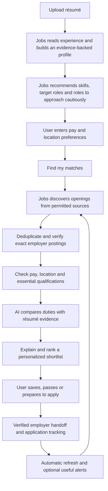

# Jobs customer workflow

**Status: proposed implementation specification, ready for product-owner review.**
This document defines the intended behavior requested by Shawn. It does not claim that the current app implements it. It expands the [approved product vision](PRODUCT-VISION.md); the [verification record](VERIFICATION.md) remains the authority for observed tests. Changes in this milestone are documentation only.

## 1. The promise

**Upload your résumé. Tell Jobs what you need to earn and where you can work. Jobs builds your search, finds real openings, and explains which ones deserve your attention.**

The paying customer supplies personal facts and makes career decisions. Jobs performs the recruiting work: understands experience, identifies useful skills, recommends target roles and adjacent opportunities, searches permitted sources, checks employer postings, evaluates fit with AI, and maintains a current shortlist. The customer never has to configure an API, choose employer feeds, maintain keyword lists, assign skill weights, or evaluate every incoming listing to obtain recommendations.

Automatic does not mean applying without permission. Jobs recommends and prepares; the customer chooses whether to apply and approves anything submitted on their behalf.

## 2. The end-to-end journey

One final **Find my matches** action confirms the initial inputs and starts the whole search. There are no separate required actions to generate roles, enable AI, select skills, configure sources, run each search, or request each match explanation. Subsequent refreshes happen automatically under a visible service schedule. Refresh now remains available.

## 3. First launch and résumé import

### What the customer sees

After account access, a clear introduction and **Upload résumé** action. Explain briefly that Jobs uses AI to read the résumé and compare it with jobs, with access to the data-use and deletion controls. The paid product has a managed service connection; server addresses and provider keys belong to operator setup. The private prototype may retain connection settings outside this journey.

Support PDF and DOCX as the initial product contract, including text recognition for scanned PDFs. Offer pasted experience or a short guided work-history entry as an alternative. These are implementation requirements, not statements of current format support.

### What Jobs does automatically

1. Validate and safely read the file; distinguish an unreadable file from an empty résumé.
2. Extract employment history, dates, responsibilities, accomplishments, education, credentials, tools and explicit skills.
3. Calculate experience without counting overlapping jobs twice. Describe uncertain dates honestly; do not turn a career length into years of experience in every skill.
4. Build a versioned candidate profile with source passages supporting each extracted fact.
5. Distinguish stated qualifications from inferred transferable skills and information not found.
6. Generate an initial search strategy and role recommendations from that profile.

Show truthful progress such as **Reading your résumé** and **Building your search profile**. Do not show fabricated percentages. Save progress so returning to the app does not require re-uploading.

### Completion rule

The profile contains enough résumé-backed experience to search without manual copying, selecting every skill, or entering a target title. A compact summary might say “Your experience centers on medical billing, denied claims and payer follow-up.” Offer **Edit** and **Why these suggestions?**, but do not require approval of every extracted item.

Ask a focused question only when the missing fact prevents a safe next step. A badly scanned résumé needs another readable input. An ambiguous optional skill does not block the entire process. Never invent a license, degree, employment date or achievement to complete a profile.

## 4. Automatic career strategy

Jobs produces these outputs before the first search and updates them when the profile changes:

| Output | Required behavior |
| --- | --- |
| Core skills to emphasize | Identify skills supported by work examples, not just terms in a catalog. Explain which experience supports them. |
| Primary target roles | Recommend roles whose duties fit the candidate's evidence and level of responsibility. Include title variations automatically. |
| Adjacent roles | Suggest transferable opportunities and state the bridge between existing work and new duties. Label meaningful gaps. |
| Stretch opportunities | Separate plausible advancement from close matches; explain additional expectations. |
| Roles to approach cautiously | Explain specific missing requirements, mismatched duties or stated preference conflicts. Avoid blanket career judgments. |
| Search strategy | Translate the above into searches across supported sources without requiring the user to construct queries. |

Recommendations are editable. An AI suggestion to avoid a role is advice, not a permanent exclusion. Only an explicit user instruction or a confirmed hard requirement excludes it outright. “No evidence of a nursing license” means the license is unconfirmed; it does not prove the person lacks one. Jobs may ask when that distinction affects a promising opportunity.

Do not infer preferences or suitability from age, name, disability, family status or other protected characteristics. A résumé address may suggest a location to confirm; it does not establish work authorization or consent to relocation.

## 5. The essential customer inputs

Keep these on a short **What works for you?** screen. Roles and skills are already populated and available behind optional edits.

### Pay

- Ask for desired minimum base pay, currency, and hourly or annual units.
- Offer a simple **Required minimum / Flexible target** choice, with the default clearly visible.
- Treat a required minimum as a constraint; never quietly lower it to fill the shortlist.
- A published range entirely below a required minimum is excluded from close matches. A range starting at or above it meets the pay requirement. A range crossing it is “Pay needs confirmation,” since an offer at the minimum is not established.
- Missing pay is “Pay not disclosed,” not an invented estimate or a confirmed failure. It can appear in a separate needs-confirmation group by default; the user can choose to hide it.
- Preserve currency, period and compensation type. Do not silently compare hourly pay to annual pay using assumed hours, or total compensation to base salary.

### Location and work arrangement

Ask where the person will actually work, with a disambiguated city/region/country, and whether they want remote, hybrid, on-site or a combination. Expand only the applicable questions:

| Preference | Meaning and matching rule |
| --- | --- |
| Office/commute location | Where the person is willing to attend an office. Include an acceptable distance and optional additional locations. Distance must not be presented as a verified travel time. |
| Remote work location | The country and state/region from which the person will perform remote work. Compare it against the employer's hiring restrictions. |
| Hybrid | Must satisfy both the applicable hiring restrictions and the office commute requirement; disclose attendance expectations. |
| Relocation | Optional willingness and destination choices, never inferred from a résumé or widened automatically. |

A remote job is not necessarily available everywhere. “Remote — US, excluding Oregon” cannot be a close match for someone working in Oregon. “Remote — US” with no state restrictions established remains uncertain when eligibility matters. An office within commute distance does not prove remote eligibility, and remote eligibility does not make a distant office commutable.

Work authorization, sponsorship, schedule or a mandatory credential can require a short follow-up when relevant. Do not collect an exhaustive questionnaire before showing value. New profiles never inherit Shawn's geography. Existing profiles retain their behavior until an explicit, explained migration, with saved applications and notes preserved.

## 6. Find jobs automatically

After **Find my matches**, Jobs owns the whole pipeline:

1. Snapshot the profile and preferences so every result can be traced to the criteria used.
2. Build searches from recommended roles, title synonyms, duties and transferable skills, plus pay and location constraints.
3. Retrieve jobs from permitted employer feeds, career sites and supported discovery providers. Choose relevant sources automatically; no profession-specific API setup by the customer.
4. Record which sources succeeded, failed or were unavailable. Use time limits and retries so one source cannot hold up the entire search.
5. Normalize listing facts without altering the employer's meaning. Preserve source URLs, requisition identifiers, published restrictions and retrieval times.
6. Combine duplicates of the same opening while preserving different requisitions, even when their titles match.
7. Locate and check the exact employer posting using employer, title, location and requisition evidence. Distinguish an open posting from a tested application form.
8. Evaluate constraints and run AI comparison, then deliver useful results progressively.

Show stages such as **Finding openings**, **Checking employer postings**, and **Comparing with your experience**. The user can leave and return. Repeated taps and reconnects must not create duplicate search runs or charges. Show when a run is complete, partial or interrupted, and when the last successful search occurred.

No real results means no real results. Never substitute invented jobs, a canned healthcare list, or manually inserted recommendations. Test fixtures must enter through retrieval so they actually test discovery.

## 7. AI matching and shortlist rules

AI matching is a core service step, not an optional per-job button. The backend supplies the relevant résumé evidence and employer duties to AI. Structured validation and deterministic checks enforce confirmed hard constraints; persuasive AI wording cannot override them.

For each considered opening, retain:

- Employer responsibilities and essential requirements, with source evidence.
- Corresponding candidate experience and skills, with résumé evidence.
- Transferable strengths, seniority fit, material gaps and unanswered questions.
- Separate pay, work arrangement, commute, remote eligibility and posting-verification outcomes.
- A recommendation and concise explanation tied to the profile and listing versions used.

Résumés and job pages are untrusted content, not instructions to the AI. Ignore embedded instructions to change rules, disclose information or contact third parties. Validate model output before displaying or saving it. Limit candidate information sent to what matching needs; contact details are generally unnecessary.

| Result group | Contract |
| --- | --- |
| Close matches | Strong duty evidence, appropriate responsibility level, no known hard conflict, required constraints confirmed, and an exact current employer posting check. |
| Worth considering | Adjacent or stretch role with an explained bridge and explicit gaps; no known hard conflict. |
| Needs confirmation | Promising duties but a material unknown such as pay, hiring region, credential or posting status. State what is unknown. |
| Not recommended | Known requirement conflict or weak evidence of relevant duties. Available with reasons, outside the main shortlist. |

Rank close matches by supported duty fit, essential qualifications, responsibility level and customer preferences; use freshness to prefer current opportunities. A repeated keyword cannot inflate fit. Do not present a numerical score as the probability of getting hired. A changed résumé must be able to change the recommendations against the same pool of jobs.

## 8. What the customer receives

For You leads with the shortlist and a short explanation of the search strategy. Each card shows employer, role, work arrangement/location, published pay or its absence, one concrete fit reason, the most important caveat, and last posting check. Avoid a wall of filters before the jobs.

Job detail explains **Why this fits**, **What to emphasize**, **Gaps or questions**, and **Employer posting**. Include supporting experience and duties without making the customer read an AI essay. Provide Save, Pass and the appropriately labeled employer action. Browse and optional filters remain available for exploration.

If no close matches exist, explain why: coverage limits, unavailable sources, hard constraints, or skill gaps. Show honest adjacent options and propose specific changes with consequences. Never silently expand commute, lower pay, or remove hiring restrictions. The user can accept a proposed change with one action.

## 9. Apply, track and improve

1. Saving adds the opening to My Jobs without marking it applied.
2. Preparation recommends truthful résumé emphasis and drafts materials grounded in existing evidence. The customer reviews and edits before use.
3. Open the verified employer application for the same requisition. If verification is unavailable, label the link and limitation clearly; do not call it verified or replace it with another job.
4. On return, offer **Did you apply?** Opening a link alone never marks an application submitted.
5. Record status, notes, dates and follow-ups independently from employer listing refreshes. Support applications found outside Jobs.
6. Pass feedback is optional, reversible and scoped: dismiss this opening by default; broader exclusion requires the user's choice. Explain any future recommendation change.
7. Refresh sources and reassess changed listings automatically. Preserve application history when a job closes or no longer fits. Send new-match or material-change alerts only under the user's notification preferences, without duplicates.

## 10. Failures must remain usable

| Situation | Required response |
| --- | --- |
| Unsupported, encrypted or unreadable résumé | Explain the issue and offer a readable file or pasted experience; preserve other inputs. |
| AI timeout, invalid output or service limit | Preserve the résumé and preferences, retry safely and show the actual state. Never present catalog extraction or rules-only ranking as completed AI work. Previously analyzed results remain dated. |
| Source outage | Deliver results from working sources with partial-coverage status; retry the failed portion. |
| No relevant sources available | Explain the coverage gap; do not imply the candidate is unqualified or ask them to administer feeds. |
| Closed or mismatched posting | Remove from active close matches, preserve saved history and explain the link state. |
| Network loss or app restart | Restore progress and last synced results with timestamps; prevent duplicate operations on retry. |
| New résumé or preference edit during search | Version the new input and rerun affected work; do not display old results as if assessed against the new criteria. |
| Conflicting edits across devices | Preserve the draft and surface a recoverable conflict; do not silently overwrite newer work. |

## 11. Data ownership and paid-service boundary

Keep five responsibilities separate: employer facts and link verification; candidate facts and preferences; AI analysis; user review decisions; application tracking and materials. Each AI result records input versions and analysis time. User corrections take precedence over later extraction, and replacing a résumé does not silently erase corrections or application history.

Use one authoritative backend per live database. Customer accounts require tested isolation across requests, files, caches, background tasks and backups. Protect provider credentials on the backend. Provide correction, export and deletion controls with clear retention behavior. Service limits and any payment terms must be disclosed; do not ask customers to purchase or configure their own AI API to obtain the core workflow.

Refresh frequency, supported source coverage, file-size limits, AI usage limits and subscription price require operational validation before launch. These business decisions do not change the central automation contract. The approximate $10/month idea remains a hypothesis.

## 12. Acceptance scenarios for development

Use disposable accounts/workspaces, fictional résumés and an unfiltered fictional employer feed. Automated AI responses are controlled fixtures; they verify orchestration and handling, not live model quality. No paid provider calls are enabled merely to run tests. Live provider quality and cost require a separately authorized trial.

| ID | Scenario | Evidence required to pass |
| --- | --- | --- |
| W01 | Clean first launch | Upload is prominent. No inherited profile, jobs, geography or source-configuration task. |
| W02 | Mara, 15 years in medical billing/revenue cycle | System Files import builds experience, evidence-backed skills, primary/adjacent roles and cautions automatically. User supplies only pay and location preferences before searching. |
| W03 | Actual retrieval | Search retrieves the unfiltered fixture feed, checks employer postings and performs AI comparison. No shortlist rows were inserted beforehand. |
| W04 | Healthcare fit | Billing, denials and payer-follow-up duties rank appropriately; unrelated clinical laboratory work and roles requiring an unsupported clinical license do not appear as confirmed close matches. |
| W05 | Contrasting career | A fictional manufacturing résumé against the same feed produces a different strategy and shortlist supported by its own evidence. No healthcare or IT hard-coding. |
| W06 | Separate geography | Test a local office, distant hybrid office, allowed remote region, expressly excluded region and unknown eligibility. Each gets the correct separate result. |
| W07 | Pay | Test above, below and crossing ranges, undisclosed pay, hourly units and another currency. Unknowns stay explicit; no silent conversion. |
| W08 | Identity and freshness | Duplicate source copies collapse; separate requisitions remain separate; closed, wrong and unreachable links cannot be verified close matches. |
| W09 | Corrections | An edited skill, excluded role or replacement résumé updates affected matches and preserves explicit corrections and tracking. |
| W10 | Recovery | AI failure, source timeout, lost response, repeated taps and app relaunch preserve progress without duplicate operations or false success. |
| W11 | Apply and return | Save, employer handoff, explicit applied confirmation, notes and follow-up survive refresh and reconnect. |
| W12 | Presentation | Combined cobalt design works in light/dark mode, large text and VoiceOver; returning from detail preserves context. |
| W13 | Customer security | Separate accounts cannot access one another's files, searches, advice or application history; deletion and credential handling are tested before public release. |

For W02–W12, walk the rebuilt journey on iPhone 17 in Device Hub and record expected versus actual behavior with build and commit identifiers. Keep fictional screenshots and résumé artifacts outside Git. Clearly distinguish simulator observations from physical-device evidence. Browser tests run sequentially on the shared QA port. Record hosted CI and live-provider results separately.

## 13. Current gap and implementation order

The prior isolated first-run walkthrough recorded that résumé import suggested catalog skills, but experience and target roles stayed blank. Saving a skill alone could not complete the profile. Search and an AI-generated shortlist were not reached. Fictional listings already in that workspace were not evidence of discovery. That observation motivates this specification; it is not a new test of the current branch.

Deliver the next implementation as one coherent vertical journey:

1. Automatic résumé profile and evidence-backed career strategy, with optional corrections.
2. Short pay/location onboarding with distinct commute and remote eligibility rules.
3. A single orchestrated discovery, verification and AI matching run with persisted progress and recovery.
4. Explained shortlist, employer handoff and preserved application tracking in the modernized design.
5. Clean-run acceptance evidence across contrasting careers, followed by separately authorized provider validation and the paid-service security/operations gates.

Before coding each part, map it to the acceptance IDs above. Update the verification record with what actually happened, including failures. A polished screen, passing mocked AI tests, or manually curated jobs cannot substitute for demonstrating the complete journey. Implementation should begin after this workflow has been reviewed, without relabeling current prototype behavior as the intended product.
